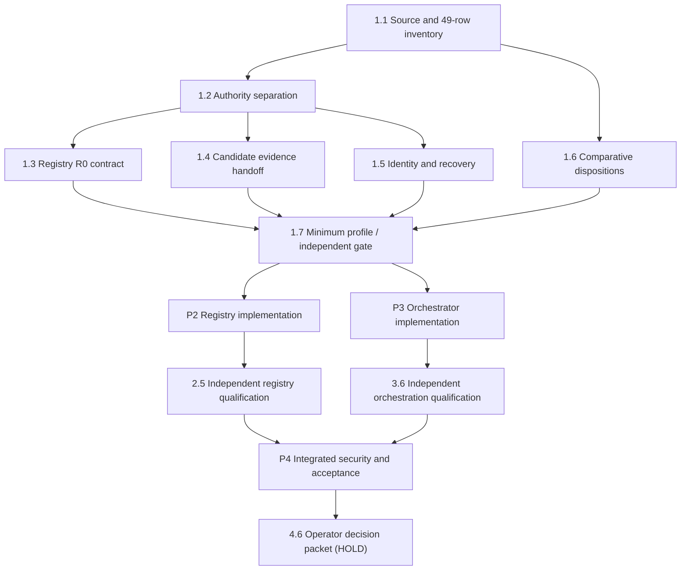

# Open Control Stack — v0.2 engineering program (proposal)

**Non-authorizing, documentation-only planning.** Release and production remain on HOLD. Nothing in this directory starts a worker, selects a new component lock, changes a security boundary, authorizes paid calls, declares a qualification PASS or approves publication.

## Three authority layers

1. **Architecture and governing authority:** the hub component lock, architecture and contracts, `docs/declarative-governance-registry.md`, exact operator decisions, release limitations and the independently adopted revision of the [Engineering Constitution](https://github.com/cogno-us/cognous-engineering-constitution). A planning document does not supersede them.
2. **Stateless engineering program:** this directory defines proposed phases, 24 bounded steps, dependencies, S01–S12 delivery packaging, source and ownership mapping, acceptance obligations, uncertainty and decision boundaries. A mini-sprint packages existing steps; it is not an extra requirement or authority to execute.
3. **Live execution and qualification telemetry:** [hub program controller #193](https://github.com/cogno-us/cognous-open-control-stack/issues/193) owns assignments, candidate PRs, dependencies and integration status; [Qualification controller #218](https://github.com/cogno-us/cognous-stack-qualification/issues/218) independently records frozen expectations, observations, evidence, limitations and verdicts. Neither controller comment may alter architecture, qualified claims or release authority.

The 49 original proposed register rows are preserved in [original-register.md](original-register.md). The S01 [crosswalk](s01/crosswalk.md) maps all 49 rows to steps. [Historical status](historical-status-snapshot.md) is retained, while [status.md](status.md) is only a compatibility pointer, not live counters. No exact constitution revision is adopted through this documentation change.

## Four phases / 24 steps

| Phase | Steps | Reviewable phase exit |
|---|---|---|
| P1 — Contracts and ownership | 1.1–1.7 (7) | Every source and authority boundary reconciled, frozen minimum profile and independent criteria |
| P2 — Registry-backed governance | 2.1–2.5 (5) | Versioned rule data and typed checks with independent old/new and adversarial qualification |
| P3 — Operational orchestration | 3.1–3.6 (6) | Bounded single-host durable workflow, existing effect gates, truth-preserving recovery and independent qualification |
| P4 — Integrated candidate | 4.1–4.6 (6) | Exact-source compatibility, enforcement coverage, known-limit dispositions, scoped independent evidence and operator decision packet |

These phases are not a permission sequence. After frozen P1 contracts, disjoint P2 registry and P3 orchestration implementation may proceed in parallel **only when separately authorized**. Shared authority contracts, registry activation, source selection and final integration require serialized ownership.

## Source and artifact index

| Artifact | Role |
|---|---|
| [engineering-register.md](engineering-register.md) / [JSON](engineering-register.json) | 24 step-level obligations, prerequisites, ownership roles, exits, stops and effort dimensions |
| [original-register.md](original-register.md) | Immutable historical 49-row starting inventory; no silent deletion |
| [source-register.json](source-register.json) | Provenance, exact source revisions and the S01 crosswalk pointer |
| [operator-decisions.md](operator-decisions.md) | Prior decisions, open choices and reserved operator powers |
| [mini-sprints.md](mini-sprints.md) | S01–S12 entry/exit/rollback and review boundaries |
| [minimum-profile.md](minimum-profile.md) | Bounded nonproduction candidate and exclusions |
| [minimum-estimate.md](minimum-estimate.md) / [JSON](minimum-estimate.json) | Preliminary source-grounded low/central/high effort (minimum profile separate from the full plan) |
| [modules.md](modules.md) | Workstream-to-component responsibility map |
| [qualification.md](qualification.md) | Independent evidence record and oracle design obligations |
| [security-and-recovery.md](security-and-recovery.md) | Threat and unknown-effect reconciliation contract |
| [s01/](s01/README.md) | S01 source packet: inventory, 49-row crosswalk, defect register, known-issue ownership, comparative assessment and estimates (review draft) |
| [comparative-review.md](comparative-review.md) | CA-01 to CA-06 preliminary dispositions |
| [review.md](review.md) | Open architecture questions and completion checklist |
| [integrity-manifest.json](integrity-manifest.json) | Source file identities and integrity method |
| [historical-status-snapshot.md](historical-status-snapshot.md) | Preserved prior dated status; not current state |

## First reviewable sprint — S01

S01 first inventories selected source pins and component responsibilities, maps **all 49** historical rows to new steps/deferred dispositions, audits known v0.1 D/R/M limitations, reconciles the exact Engineering Constitution revision, resolves source-backed CA-01–CA-06 questions and frames minimum-profile threats. It ends with a reviewable source/contract packet, **not running code**. Subsequent architecture or implementation needs an authorized work package, reviewed interfaces, independently frozen expectation owner and documented stop conditions.

**Resource selection:** no additional paid execution or cloud authorization. **Unsupported claims:** no fleet, production, remote settlement, distributed atomicity, certification or end-to-end operational trust. No release or deployment promotion.
